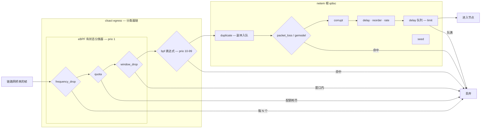

# Packet Filter 规则参考（中文版）

> 整理日期：2026-10-15
> 性质：**参考手册**——译整理自 gns3-server 仓库 `docs/features/packet-filters.md`（同日版本）；参数范围与跨规则约束以 `gns3server/utils/packet_filter_validation.py` 的 `VALIDATION_RULES` 为准；实测数据转引自本仓库各实验记录（见 §9）。
> 一句话：**链路 `filters` 字典配 13 种损伤规则，双端各自施加、每方向恰好损伤一次；其中 8 种整型 + 2 个参数仅内核数据面（同机 kernel datapath）可用，relay 链路只有基础 5 种。**

---

## 1. 概述

Packet filter 是按链路配置的损伤规则——时延、丢包、误码、限速、确定性丢弃等——写在链路的 `filters` 字典里，由**链路两端各自施加**，因此链路的每个方向恰好被损伤一次。由此的换算关系：

- `delay 100` → 往返 RTT ≈ **200 ms**
- `packet_loss 30` → 往返丢包 ≈ **51 %**（1 − 0.7²）

两条数据面实现：

- **内核数据面**（同机链路）：filter 以 **tc 对象跑在内核里**，uBridge 通过 netlink 安装（`tc netem set`、裸 netlink，不需要 `tc` 二进制）——每锚点一个 netem qdisc、若干 cls_bpf match-drop 分类器、一个 eBPF 有状态分类器
- **relay 链路**（跨机）：uBridge 用户态 filter 跑在单个 relay 网桥上，只支持 **5 种**（`delay` / `packet_loss` / `corrupt` / `frequency_drop` / `bpf`），其余为内核专用

## 2. 术语

| 术语 | 含义 |
|---|---|
| anchor（锚点） | 链路附着的主机侧接口——Docker 适配器的 veth 宿主端，QEMU / IOU / Dynamips 适配器的持久 TAP |
| tc / qdisc | 内核插进锚点出口路径的流量控制对象——帧飞行途中经过的"关卡"，不是外部的报文消费者；uBridge 只经 netlink 安装 |
| `clsact` | 锚点上的 tc 分类器载体；丢包分类器挂在它的 egress 链 |
| netem | clsact 后面的损伤 qdisc：delay、loss、rate、corrupt、duplicate…… |
| eBPF 分类器 | clsact egress prio 1 的有状态丢包分类器——every-Nth / quota / 时间窗 / flow 四种模式（GNS3 暴露前三种） |
| `bpf_drop` | clsact egress prio 10–99 的 match-drop BPF 表达式 |
| relay filter | relay 网桥上的 uBridge 用户态 filter——两个方向都过同一个被过滤的网桥 |

## 3. 13 种规则参数速查

控制器侧 API 面（校验先于一切下发）。**尾部参数一律可选**：只发前 N 个值同样合法。**K** = 内核数据面专用整型（relay 链路上 `available_filters` 直接隐藏、下发返回 409）；另有 2 个**参数级**内核专用，在表内标注。**UI 名称**列 = Web UI / `available_filters` 实际显示的名字（源：`gns3server/controller/link.py` 的 `FILTERS` 目录）——`gemodel` 在界面上叫 *Gilbert-Elliot loss*，看不到 "gemodel" 这个词是正常的。

| 规则 | UI 名称 | 参数 | 约束 |
|---|---|---|---|
| `delay` | Delay | Latency（1…32767 ms）· Jitter（0…32767 ms）· Distribution | Distribution **内核专用**，需 Jitter > 0 |
| `packet_loss` | Packet loss | Chance（0…100 %）· Correlation（0…100 %） | Correlation **内核专用**；Chance ≲ Correlation 时有效丢包塌缩（§6） |
| `corrupt` | Corrupt | Chance（0…100 %） | |
| `duplicate` **K** | Duplicate | Chance（0…100 %）· Correlation（0…100 %） | |
| `rate` **K** | Bandwidth limit | Rate——tc 风格字符串，如 `"512kbit"`（≤ 100gbit） | 整数 + 单位（bit/kbit/mbit/gbit 按比特/s；bps/kbps/mbps 按字节/s） |
| `reorder` **K** | Reorder | Reorder（0…100 %）· Correlation（0…100 %）· Gap（1…1000 包） | **必须同时设 `delay`** |
| `gemodel` **K** | Gilbert-Elliot loss | p (good-to-bad) · r (bad-to-good) · 1-h (bad-state loss)（各 0…100 %） | **与 `packet_loss` 互斥** |
| `seed` **K** | Random seed | Seed（0…4294967295） | 只固定 netem 抽签 |
| `limit` **K** | Queue limit | Limit（1…1000000 包） | 损伤队列深度（默认 1000） |
| `bpf` | Berkeley Packet Filter (BPF) | Filters——文本，**每行一条表达式** | 任意一行命中即丢 |
| `frequency_drop` | Frequency drop | Frequency（−1…32767） | −1 = 全丢；0 = 禁用 |
| `quota` **K** | Byte quota | Quota（1…10¹⁵ 字节）· Chance（0…100 %） | 两参都必填；Chance 100 = 硬截止 |
| `window_drop` **K** | Time window drop | Start（0…10¹² ms）· Outage（1…10¹² ms）· Chance（0…100 %）· Period（1…10¹² ms）· Jitter（0…10⁹ ms） | 3/4/5 参 = 单次 / 周期 / 随机抖动中断；Period ≥ Outage |

**跨规则约束**（违反返回 409）：

- `reorder` 需要 `delay`
- `gemodel` 与 `packet_loss` 互斥（都映射到 netem 的 loss 槽位）
- `window_drop` 的 Period ≥ Outage
- `delay` 的 Distribution 需 Jitter > 0
- `rate` 必须是整数 + 单位，≤ 100gbit

**禁用约定**：首参为 0（或空串）视为关闭、直接跳过。两个例外——`delay [0, 0]` 是显式关闭，而 `delay [0, X>0]` 报校验错（Latency ≥ 1）；`window_drop` 只要存在就是启用（`Start = 0` 表示中断立即开始，不是"关闭"）。

## 4. 逐条详解：用途与参数

§3 的速查表回答"能填什么值"，本节回答"这条规则拿来干什么、每个参数是什么意思"。小节顺序与 §3 速查表一致；标题中的（内核专用）表示该类型只能在内核数据面链路上下发。

### 4.1 `delay` — 固定时延 + 抖动

**用途**：模拟链路传播时延——地理距离（城际光纤）、卫星跳（500+ ms）；放大 RTT 观察 TCP 窗口/BDP、OSPF 计时器、VoIP 与交互体验；与 `rate` 组合塑造"窄带高延迟"链路。

| 参数 | 说明 |
|---|---|
| Latency（1…32767 ms） | 每方向叠加的固定单向时延；两端各施加一次 → RTT ≈ 2×。最小值 1；`[0, 0]` 组合 = 显式关闭 |
| Jitter（0…32767 ms） | 每包时延在 Latency ± Jitter 内随机抽取；不填 = 0 |
| Distribution（uniform / normal / pareto / paretonormal） | 抖动偏移的抽样分布形状（**内核专用**，需 Jitter > 0；不填 = uniform），四个值的对比见下表 |

**Distribution 四个值的含义**（以 Jitter = 5 ms 为例）：

| 分布 | 形状 | 抽出来的效果 | 适用场景 |
|---|---|---|---|
| uniform（默认） | 矩形、平坦 | −5…+5 ms 等概率取每个值，硬边界 | 最简模型：最坏情况就是 ±J，行为最容易推理 |
| normal（高斯） | 钟形 | 多数包偏移集中在 0 附近，越极端越罕见，几乎不会碰到 ±5 | 温和、集中的抖动——同机房直连、优质专线 |
| pareto | 重尾（L 形） | 大多数包偏移 ≈0，偶发尖峰可达典型值的数倍 | 排队尖峰、拥塞瞬间；压测超时/重传逻辑（uniform/normal 造不出"偶发大尖峰"） |
| paretonormal | 钟形身 + 帕累托尾 | 多数集中 + 偶发尖峰 | 最贴近真实 Internet/WAN 实测；netem 官方推荐的默认抖动模型 |

真实网络的抖动之所以重尾：时延变化主要来自**排队延迟**——buffer 瞬间占满就冒一个大尖峰，平时很稳、偶尔抽风，正是"钟形身 + 重尾"。仿机房内链路 normal 足够，仿广域网用 pareto / paretonormal。

**注意**：挂起恢复后首包多走一个间隔（netem 空闲基线，稳态精确）；大 delay 配 `rate` 时记得按 §4.9 调大 `limit`。

**示例**：`{"delay": [80, 5, "paretonormal"]}` — 每方向 80 ± 5 ms，重尾抖动。

### 4.2 `packet_loss` — 随机丢包

**用途**：模拟无线链路误丢、拥塞 tail-drop；测 TCP 拥塞退避与重传、应用层重试、协议容错。

| 参数 | 说明 |
|---|---|
| Chance（0…100 %） | 每包独立丢弃概率，每方向独立——往返实测丢包 ≈ 1−(1−P)² |
| Correlation（0…100 %，**内核专用**） | 相邻丢包相关性——前一包丢了，本包的丢包概率上调，形成连续丢包（突发） |

**注意**：**Chance ≲ Correlation 时有效丢包向 0 塌缩**（内核 netem 缺陷，定量数据见 §6）——已知均值的突发丢包改用 `gemodel`；relay 链路上此参数会被剥掉（只发单参照常工作）。

**示例**：`{"packet_loss": [2]}`；带关联 `{"packet_loss": [10, 25]}`（10 < 25 已在塌缩区，实测有效丢包仅 ≈1.8 %，此处仅示意语法）。

### 4.3 `corrupt` — 误码

**用途**：模拟劣质物理层——CRC 错、无线干扰、光模块劣化；测校验和覆盖、重传、FEC。

| 参数 | 说明 |
|---|---|
| Chance（0…100 %） | 每包内容被破坏的概率。破坏后**放行**，由接收端校验和判死——链路抓包能看到带伤帧 |

**示例**：`{"corrupt": [5]}`。

### 4.4 `duplicate` — 重复包（内核专用）

**用途**：真实原型是**无线链路层重传**——802.11 ARQ 因 ACK 丢失重传、对端其实第一次就收到了，WiFi 侧 1~3 % 重复帧是常态；瞬时 L2 环路（STP 收敛窗口）、链路聚合切换也会产生。测协议幂等性与序列号/去重处理（TCP 按序列号天然免疫；非幂等的应用逻辑会执行两次副作用）。

| 参数 | 说明 |
|---|---|
| Chance（0…100 %） | 每包被复制一份的概率（原包照走，加发一份副本） |
| Correlation（0…100 %） | 相邻重复的关联度——无线重传在时间上聚簇（信号差的时段连着重传），关联度模拟这个；Chance ≲ Correlation 同样塌缩，见 §6 |

**注意**：副本独立抽自己的 delay（`delay 100` 下重复帧与原帧到达时间不同）；重复类没有 gemodel 等价物，要突文化只能把 Chance 抬到 Correlation 之上。

**示例**：`{"duplicate": [2]}` — WiFi 式轻度重复；`{"duplicate": [10, 25]}` — 语法示意（10 < 25 在塌缩区，实测有效重复率仅 ≈1.8 %）；`{"duplicate": [25, 25]}` — 概率 ≥ 关联度不塌，有效值 ≈16.7 %（实测锚点）。

### 4.5 `rate` — 带宽限速（内核专用）

**用途**：把链路限速成窄带接入（512k / 2M 专线）、制造带宽瓶颈；测 QoS、队列与大流量行为。

| 参数 | 说明 |
|---|---|
| Rate | tc 风格字符串"整数 + 单位"：`bit` / `kbit` / `mbit` / `gbit` 按比特/s；`bps` / `kbps` / `mbps` 按字节/s；上限 100gbit |

**注意**：限速是**每方向独立整形**（对称全双工）：两端各挂一个 shaper，A→B 打满 10 Mbit/s 的同时 B→A 也能打满 10 Mbit/s——不是共享预算。不对称速率（如 20M 下 / 1M 上）link filters 表达不了，须在两端 guest 内各打 netem。每包串行化时延 ≈ 包大小 / 速率，双向各一次 → RTT 增加约 2×；大 `rate` 配大 `delay` 时按 §4.9 调大 `limit`。

**示例**：`{"rate": ["512kbit"]}`。

### 4.6 `reorder` — 乱序（内核专用）

**用途**：模拟多路径转发（ECMP、链路聚合）与交换机并行走出的乱序；测 TCP SACK、重排缓冲、RACK。

| 参数 | 说明 |
|---|---|
| Reorder（0…100 %） | 该包被扣住、直到后面的包越过它才放行的概率 |
| Correlation（0…100 %） | 连续乱序的相关性 |
| Gap（1…1000 包） | 乱序节奏——每 gap 个包中 1 个立即发送、其余扣下延迟，形成固定节奏的乱序；不设则纯按概率随机 |

**注意**：**必须同时设 `delay`**（校验 409）。物理机制是**跳队**：delay 把包扣在 netem 队列里等到点，reorder 让被抽中的包跳过等待立即发送、越过还在排队的前辈——被扣的包占的就是 `limit` 管的那个队列，高速率 + 大 delay + 高乱序比例同样会顶到 limit 队尾丢包（§4.9）；乱序深度也天然受 delay 约束（最多被压 delay ms）。

**示例**：`{"delay": [50], "reorder": [25, 25, 5]}` — 50 ms 链路上 25 % 乱序、节奏 5 包。

### 4.7 `gemodel` — 突发丢包，Gilbert-Elliot 模型（内核专用）

**用途**：真实网络丢包是突发的——微突发拥塞、设备内存瞬时耗尽、无线衰落。要"已知平均丢包率 + 可调突发长度"时用它（替代 `packet_loss` + correl，且不受塌缩影响）。

| 参数 | 说明 |
|---|---|
| p (good-to-bad)（0…100 %） | 好→坏转移率：好态下每包进入突发期的概率，突发间隔平均 ≈ 1/p 包 |
| r (bad-to-good)（0…100 %） | 坏→好转移率：突发期平均长度 ≈ 1/r 包 |
| 1−h (bad-state loss)（0…100 %） | 坏态内每包丢包率（好态不丢） |

稳态单向平均丢包 = **p/(p+r)×(1−h)**（"单向"= 每方向独立承受此均值：两端各挂一个独立实例、状态机互不相关，往返丢包 ≈ 1−(1−mean)²；要"只丢单方向"得在节点内部自己打 netem，link filters 只能对称下发）。

**注意**：与 `packet_loss` 互斥（同一 netem loss 槽位，同时下发校验 409）。

**同均值、不同剧本**——对协议影响天壤之别（散点丢包触发 TCP 快速重传；整窗突发直接打穿拥塞窗口跌进 RTO）：

```
packet_loss [5]（独立）：──X───X────X───X────X───X──          每包各自 5%，均匀分散
gemodel [1,19,100]（突发）：────────▒▒▒▒▒───────────▒▒▒──      长时间全通，连死 ≈5 包，间隔 ≈100 包
```

**选参配方**：先定目标均值 M 与期望平均突发长度 L（包）→ r ≈ 1/L，p ≈ M×r/(1−M)（1-h=100 时）；突发内要留幸存者就调低 1-h。

**示例**：`{"gemodel": [1, 19, 100]}` — 平均 5 % 丢包，突发平均 ≈5 包且突发内全丢，突发间隔 ≈100 包。

### 4.8 `seed` — 固定随机种子（内核专用）

**用途**：实验可复现与 A/B 对比——同一 seed + 同一 filter 集 → 完全相同的丢包/抖动/误码/复制序列。

| 参数 | 说明 |
|---|---|
| Seed（0…4294967295） | netem PRNG 种子 |

**注意**：只固定 netem 抽签——eBPF（quota / window）的百分比抽签在程序加载时另行播种，`seed` 够不着；filter 集任何变更都会重置时间表与计数器。另两个边界：复现还要求**流量图案相同**（抽签按到达的包逐个消耗，前置的 bpf / nth 丢包会改变消耗序列）；固定 seed = 钉死"无穷多份剧本中的一份"，不是固定分布——统计结论（如平均吞吐）请换多个 seed 各跑一轮。

**示例**：`{"packet_loss": [10], "seed": [42]}`。

### 4.9 `limit` — 损伤队列深度（内核专用）

**用途**：netem 待发队列的容量，专门配合 `rate` + `delay`：积压趋向带宽时延积（BDP），超过 limit 队尾丢包——丢"没有任何 filter 要求丢"的包。单独设置基本无效果（没有延迟就没有积压）。

| 参数 | 说明 |
|---|---|
| Limit（1…1000000 包） | 队列可缓存的包数，默认 1000 |

**经验值**：limit ≈ rate × delay / 平均包大小，再留余量。

**症状对号**：设了 rate + delay 却实测吞吐跑不满配置速率、或出现没配置过的丢包——多半是默认 1000 被 BDP 溢出（队尾丢包），调大 limit。

**示例**：`{"rate": ["10mbit"], "delay": [2000], "limit": [5000]}` — 10 Mbit/s × 2 s ≈ 2.5 MB ≈ 1700 个 1500 B 包，已超默认 1000 → 调到 5000。

### 4.10 `bpf` — 按内容丢弃

**用途**：选择性流量黑洞——只丢 ICMP（ping 黑洞）、只丢 BGP（`tcp port 179`）看邻居失联、丢 OSPF hello（`ip proto 89`）测收敛、丢 VRRP 通告（`proto 112`）逼主备切换。

| 参数 | 说明 |
|---|---|
| Filters | libpcap/tcpdump 表达式，**每行一条**，任意一行命中即丢。下发前逐行经 `tcpdump -d` 编译校验；compute 上编译不过的行跳过并告警 |

**注意**：语义是 match-drop——命中才丢；要"只放行 X"写成 `not <X>`。内核（cls_bpf）与 relay（libpcap 用户态）都支持。

**示例**：`{"bpf": "icmp"}`；多行 `{"bpf": "tcp port 179\nip proto 89"}`。

### 4.11 `frequency_drop` — 周期性精确丢弃

**用途**：确定性丢包，不掷骰子——精确控制丢包节奏测最坏路径：重传、FEC、快速失败；也用于需要稳定推进丢包计数器的实验。

| 参数 | 说明 |
|---|---|
| Frequency（−1…32767） | 正数 N = 每 N 个包丢第 N 个；−1 = 全部丢弃；0 = 禁用 |

**注意**：两条数据面计数语义不同——relay 单计数器双向共相位；内核每方向独立计数（N=3 → 往返丢包 55.6 %，实测 57 %）；内核为原子精确计数（见 §6）。

**示例**：`{"frequency_drop": [3]}` — 每 3 个丢 1 个。

### 4.12 `quota` — 流量配额（内核专用）

**用途**：模拟流量配额/计费——月度流量耗尽断网或降速；测应用对"用到一半断流"的韧性。

| 参数 | 说明 |
|---|---|
| Quota（1…10¹⁵ 字节） | 字节配额，每方向独立计数——耗尽前 filter 完全透明（只计数不丢包） |
| Chance（0…100 %） | 配额耗尽后**每包独立**抽签的丢弃概率——100 = 硬截止，较低值 = 降级服务。抽签数学同 `packet_loss`，但跑在 eBPF 分类器段：无 Correlation 参数（不受 correl 塌缩影响）、`seed` 固定不了、被丢的包抓包/marker 看不到（§5/§6） |

**注意**：计数从 filter 施加那一刻起算；filter 集任何变更都会重置计数（调和 = 重置 + 重灌，见 §6）。需 uBridge `ebpf=1`。

**示例**：`{"quota": [1000000000, 100]}` — 1 GB 后硬断。

### 4.13 `window_drop` — 时间窗中断（内核专用）

**用途**：计划内中断（维护窗口"链路 T 秒后断 M 秒"）、周期闪断（劣质线缆/无线衰落）、链路 flap 测路由收敛与主备切换。

| 参数 | 说明 |
|---|---|
| Start（0…10¹² ms） | 窗口起点，相对施加时刻；0 = 立即开始（合法且处于启用态） |
| Outage（1…10¹² ms） | 窗口长度 |
| Chance（0…100 %） | 窗口内**每个包独立**抽签，命中即丢——等价于"只在窗口内激活的 packet_loss"（每方向独立，往返 ≈ 1−(1−C)²；100 = 完全中断，较低 = 降级窗口） |
| Period（1…10¹² ms，可选） | 周期复发：中断发生在 [Start + k·Period, Start + k·Period + Outage)，k = 0, 1, 2…；占空比 = Outage/Period；不填 = 单次 |
| Jitter（0…10⁹ ms，可选） | 打破节拍器相位：每个周期把中断长度与周期间隔**各自独立重抽**一次，均匀取值于标称 ± Jitter（整数 ms 网格；0 = 固定时间表）——避免协议计时器与固定周期锁相 |

三种形态的时间线（▒ = 中断期）：

```
单次 [1000, 1500, 100]：
通过 ────────┬▒▒▒▒▒▒▒▒┬────────────────   （t=1.0–2.5 s 中断，前后放行）

周期 [1000, 1500, 100, 10000]：
通过 ──┬▒中断1.5s▒┬───────────────┬▒中断1.5s▒┬──────   （每 10 s 一发，占空比 15%）
     t=1.0s    2.5s          t=11.0s    12.5s

带 Jitter [0, 2000, 100, 10000, 500]：
▒~1.8s▒───── ~9.7s ─────▒~2.2s▒───── ~10.4s ─────▒~1.5s▒…   （每周期长度/间隔在 ±0.5 s 内独立重抽）
```

**注意**：**任何 filter 变更、节点重启、链路重置都会重启时间表**——已过去的一次性窗口要重新武装：做流量前立刻施加，或用 Period 求可重复。两端各跑各的时间表，往返要双向都在窗外才存活（见 §6）。需 `ebpf=1` 且 uBridge 令牌在列。

**示例**：`{"window_drop": [1000, 1500, 100]}` — 1 s 后断 1.5 s，单次；`{"window_drop": [0, 2000, 100, 10000, 500]}` — 立即断 2 s，之后每 ~10 ± 0.5 s 复发。

## 5. 求值顺序与内核实现

### 5.1 一个帧的完整关卡（内核数据面）

13 种全部启用时，一个帧在对端锚点的 egress 上按此链走——分类器链在前、单个 netem qdisc 在后，**任一阶段丢弃即终止**：被分类器丢掉的帧既到不了 netem，也到不了 AF_PACKET tap 点——**抓包和 marker 看不到它**：



这是**语义模型**而非内核源码顺序：netem 的抽签发生在入队（`duplicate` 命中则副本与原帧一起入队；`corrupt` 破坏后放行）；`delay`/`reorder`/`rate` 折叠成一个 time_to_send，由 delay 队列到期排空，`limit` 就是这个队列的容量（上图 `队满` 边）；`seed` 不是阶段，而是所有随机抽签（duplicate、loss/gemodel、corrupt、jitter）背后的 PRNG。eBPF 程序的第四种模式（flow）没有对应的 GNS3 filter 类型。

relay 数据面上没有这条链——5 种 relay 类型作为 uBridge 用户态 filter 跑在单个 relay 网桥上，两个方向过同一份 filter 列表。

### 5.2 规则 → 内核对象映射

表中 `tc …` 是 uBridge 自己的 hypervisor 命令名，**不是** iproute2 的 `tc` 二进制——uBridge 自己构造全部 netlink 消息、把 eBPF 指令阵列嵌在二进制里加载、把 `tc` CLI 会从磁盘读的抖动分布表内嵌进来；libpcap 只当库用（编译 `bpf` 表达式，与 relay filter 同一个编译器）：

| GNS3 规则 | 内核实现 | 要点 |
|---|---|---|
| `delay` | netem `delay X jitter Y [distribution D]` | jitter 0 省略；Distribution 见 §3 |
| `packet_loss` | netem `loss P [correl C]` | 每方向独立（§6）；Correlation 的塌缩问题见 §6 |
| `corrupt` | netem `corrupt P` | |
| `duplicate` | netem `dup P [correl C]` | 内核专用 |
| `rate` | netem `rate B` | 内核专用 |
| `reorder` | netem `reorder P [correl C] [gap G]` | 需要 `delay`；内核专用 |
| `gemodel` | netem `loss gemodel P R H` | 均值单向丢包 = p/(p+r)×(1-h)；内核专用 |
| `seed` | netem `seed N` | 可复现抽签；内核专用 |
| `limit` | netem `limit N` | rate+delay BDP 场景调大；内核专用 |
| `bpf` | `tc bpf_drop add <if> <prio> "<expr>"`——clsact egress 上的 cls_bpf + gact drop | 需 uBridge `cbpf=1`；某行在 compute 上编译失败则跳过该行并告警（与 relay 行为一致） |
| `frequency_drop` | `tc nth_drop <if> N`——eBPF 有状态分类器的精确 every-Nth 模式 | 需 `ebpf=1`；−1 → 每 1 个全丢；每方向独立计数 |
| `quota` | `tc quota_drop <if> <bytes> <pct>` | 需 `ebpf=1`；每方向独立字节计数 |
| `window_drop` | `tc window_drop <if> <start> <outage> <pct> [<period> [<jitter>]]` | 需 `ebpf=1`；窗口语义见 §6 |

## 6. 语义要点

- **双端各自施加**：两端各收到同一份 filter 字典、各在自己的锚点挂一套。`delay 100` → ≈200 ms RTT；`packet_loss 30` → ≈51 % 往返；`rate 512kbit` → RTT 增加约 2× 每包串行化时间。
- **Correlation 塌缩（内核 netem 缺陷，已定量）**：netem 相关抽签的混合式 `answer = (value·(2³²−ρ) + last·ρ) >> 32` 是截断而非模 2³² 回绕，平稳分布在两端被饿死——**标称 P ≲ 相关 C 时有效丢包率向 0 塌缩**。本机用原版 iproute2 `tc` 复现（uBridge 的 netlink 编码等价，数字相同）【实测】：`1% 25%` → 1000 ping 中 0 丢（理论 ≈0.0002 %）；`5% 25%` → ≈0.2 %；`10% 25%` → ≈1.8 % 单向（往返实测 3.8 %）；`25% 25%` → ≈16.7 %；标称 50 % 在任何 correl 下都是 50 %（分布对称点）。同样的边缘饿死也压低小 `duplicate`/`reorder` 概率、削薄相关 jitter 的尾部。`gemodel` 免疫（纯均匀抽签上的马尔可夫链）——**已知均值要突文化，用 gemodel**。服务端/uBridge 侧不可修（除非偏离原版 `tc` 行为）。
- **调和 = 重置 + 全量重灌**：内核 netem replace 会**合并**可选属性（rate、correlation、reorder、corrupt、gemodel、distribution——缺的属性保留旧值），所以每次施加都先 `tc reset`（顺带清掉 clsact 和 bpf_drop，随后同一流程立即重加）再按当前 filter 集全量 `netem set`，不做逐参数 diff。空 filter 集 = 只做重置（容忍 ENOENT）。
- **扩展能力门控**：netem 扩展关键字（rate、reorder、gemodel、dist、seed、limit，以及 correl 后缀——以 `rate` 令牌作为扩展版标记）按 uBridge 进程探测一次 `tc capabilities` 并要求令牌存在；纯 delay/loss/corrupt/dup 的 filter 永不探测——老 uBridge 原样服务原始面。
- **内核专用 vs relay 可用**：扩展类型 + `quota` + `window_drop` 没有 relay 等价物——relay 链路上 `available_filters` 隐藏它们、对已建 relay 链路下发返回 409；项目加载时遇到不可内核布线的链路带着这类 filter 则丢弃并告警（非法 filter 在加载时同样丢弃）。`frequency_drop` 两条数据面都能跑（relay 用户态 filter / eBPF every-Nth）。
- **frequency_drop 两种数据面计数语义不同**：relay 的单个被过滤网桥让**双向的包过同一个计数器**；内核每锚点一个分类器、**每方向独立** every-Nth。往返测量：relay ≈ 1/N（相位锁定）；内核 = 1 − ((N−1)/N)²——N=3 → 55.6 % 往返丢包【实测 57 %】。内核计数是精确的（原子计数器），不像 netem 的随机丢包。
- **分类器顺序**：clsact egress 上 eBPF 有状态分类器在 prio 1、`bpf_drop` 表达式在 10–99——被有状态模式丢掉的包到不了表达式丢弃；有状态程序内部固定顺序 nth → quota → window → flow。
- **window_drop 语义**：`start` 相对于 **filter 施加那一刻**——且由于调和每次都重设分类器（任何 filter 变更、节点重启、链路重置都会在 netem 重置后重载程序），**每个这类事件都重启时间表**。3 参 = 单次中断（`[start, start+outage)`，前后放行——经典"链路 T 时断、T+outage 恢复"）；4 参 = 周期闪断（`period ≥ outage` 校验保证，中断占每周期 outage/period）；5 参 = 随机闪断（每周期的 outage 与 period 在标称值 ± `jitter` 内均匀重抽，整数 ms 网格；jitter 0 = 固定时间表）。窗口内每包按 Chance 丢弃（100 = 完全中断，较低 = 窗口内降级）。**两端各跑各的时间表**、由控制器几乎同时启动——往返只有在**两个方向都不在窗口内**才存活。`start = 0`（立即中断）合法且处于启用态。重发未变的 filters 字典通常无事，但带 `window_drop` 的仍会调和——**已过去的一次性窗口会被重新武装**（做流量前立刻施加，或用 period 求可重复）。
- **节点重启**从 NIO 恢复 qdisc（同抓包和 marker）；**删链路**显式摘除——锚点比链路活得久，孤儿 qdisc 会继续损伤下一条链路。
- **挂起（suspend）**保留 qdisc（载波级断链）；恢复后首包多走一个 delay 间隔（netem 已知的空闲基线行为），稳态精确。
- **bpf 调和 = 清空 + 重加**（`tc bpf_drop flush`，然后按行加到 prio 10、11、…）；`tc reset`（删链路/清 filter）是 uBridge 里的完全还原：filters → clsact → 根 qdisc，幂等。
- **可观测性注意**：clsact 丢弃发生在 AF_PACKET tap 点之前——同锚点的 marker/抓包**看不到**被 cls_bpf 丢的帧（relay 上则由 filter 与 marker 的先后决定可见性）。另：`tc qdisc show` 打印不出 distribution 名字（内核只存采样表）。
- **eBPF 模式令牌制**：一个有状态模式可用 **当且仅当** `tc capabilities` 报 `ebpf=1` **且** `ebpf_modes` 列表里有该模式令牌（uBridge `feature/tc-window` 及以后）。字段出现之前的旧 build 保留其出厂模式——除 `window` 外（该模式恰在字段加入时修正过语义）：只看 `ebpf=1` 会把修正前的坏行为静默装上去。请求不可用模式会让施加失败并报升级错误；清理（"off"）路径只碰该 build 声明的模式。
- **能力上报**：compute 经 `GET /v3/compute/capabilities` 暴露探针结果 `ubridge_tc`（netem 关键字表、`ebpf`/`cbpf` 标志、可用的 `ebpf_modes`——已套旧版回退），由以 server 自身用户临时拉起的 uBridge 探测、按二进制身份缓存——同一个二进制的运行时 `ebpf` 标志随用户和内核变化，root 跑的探针会对非 root server 撒谎。controller 经 `GET /v3/computes` 转发；`available_filters` 隐藏两端 compute 任一报不能跑的内核类型（双端各施加自己的 filter，一端不行就够）。不上报的 compute（老 server、探测失败）保留全量清单；施加时的校验（409）仍是最后防线。

## 7. 组合规则

一行话模型：**确定性丢弃是 OR 门**（先杀先赢，后面不跑）、**netem 抽签是独立概率相乘**、**往返把一切平方**——同一方向内唯一的真耦合是 `limit` 给 `rate` + `delay` 造成的积压兜底。

- **分类器段组合**：被 clsact 丢掉的帧不消耗 `rate` 串行化时间、不占 delay 队列容量（`limit`）、不进任何 netem 计数——抓包/marker 也看不到（§6 可观测性注意）。有状态模式只通过计数器互动：`quota` 的字节计数只数过得了 `frequency_drop` 的包（求值有序），every-Nth 按 nth 通过率放慢配额燃烧；`window_drop` 时间表与 nth 计数器互不影响。eBPF 程序放行后帧继续走向 `bpf` 行——程序放行返回 `TC_ACT_UNSPEC` 而非 `TC_ACT_OK`，prio 链继续——两级分类器是**链**不是互斥。
- **netem 内部**：九种类型是**一次 qdisc 通过，不是九个阶段**——duplicate、loss/gemodel、corrupt 是独立抽签（概率相乘；副本自己抽 delay；corrupt 破坏后放行，留给接收端校验和去丢）；`delay`/`reorder`/`rate` 折叠成单个 time_to_send。要盯的耦合是 `limit` × `rate` × `delay`：rate 边串行边积压，积压趋向带宽时延积（BDP），超过 `limit` 后队尾丢包——**链路会丢没有任何 filter 要求丢的包**。大 `rate` 配大 `delay` 时调大 `limit`。`seed` 只固定 netem 抽签（duplicate、loss、corrupt、jitter）——eBPF 程序的百分比抽签（quota、window）骑在程序加载时种子的另一个 PRNG 上，`seed` 够不着。
- **往返组合**：两端各自实例、每方向恰好损伤一次——每方向存活率在各丢包源间相乘、往返再平方：`delay 100` → ≈200 ms RTT；`packet_loss 30` → ≈51 %；`frequency_drop 3` → 55.6 %（各类算术见 §6）。`window_drop` 两端时间表几乎同时启动，往返**双方向都在窗外**才活；`quota` 烧两个独立字节计数器。不能合并的组合——`packet_loss` + `gemodel`（一个 netem loss 槽）、无 `delay` 的 `reorder`、无 jitter 的 `distribution`、`period < outage`——在校验时拒绝（409），绝不静默合并。
- **满配示例**——`delay 100 jitter 10`、`packet_loss 10`、`corrupt 5`、`duplicate 10`、`rate 512kbit`、`reorder 25 gap 5`、`limit 5000`、`seed 42`、`bpf "icmp"`、`frequency_drop 3`、`quota 3000000 100`、`window_drop [1000, 1500, 100]`——一个 A→B 帧在 B 的锚点过这套关卡：每第 3 个发送即死（nth），否则计入 3 MB 预算、耗尽后硬切（quota），否则落在 1–2.5 s 中断窗内即丢（window），否则表达式命中即丢（bpf）；幸存者进 netem——可能被复制（副本自己抽 delay）、丢失（10 %）、损坏（5 %，带伤放行），否则在 5000 包队列里等 100 ± 10 ms、25 % 乱序、512 kbit/s 串行——`seed 42` 下每次抽签可复现。B→A 方向在 A 的锚点独立跑同一套。

## 8. REST 接口与常见配方

filter 走链路 API：链路对象上的 `filters` 字典（**规则类型 → 位置参数数组**），控制器校验（上文跨规则约束违反返回 409）后在创建、更新、项目重开时推给两端。

| 方法 | 路径 | 用途 | 权限 |
|---|---|---|---|
| GET | `/v3/projects/{project_id}/links/{link_id}` | 读链路（含 `filters`） | Link.Audit |
| PUT | `/v3/projects/{project_id}/links/{link_id}` | 替换 `filters` 字典 | Link.Modify |
| GET | `/v3/projects/{project_id}/links/{link_id}/available_filters` | 本链路可用的规则清单（含参数名/范围/单位） | Link.Audit |

设 filter 就是普通链路更新——只发 `filters` 属性：

```json
PUT /v3/projects/{project_id}/links/{link_id}
{
    "filters": {
        "delay": [50, 5],
        "packet_loss": [1]
    }
}
```

`available_filters` 是**每链路的权威词表**：内核专用类型只出现在两端 compute 都上报能跑的内核数据面链路上，relay 链路只列 5 种 relay 类型。

常见配方（所有值都是**每方向**——往返时延翻倍、丢包按 §6 复合）：

| 目标 | `filters` 值 |
|---|---|
| WAN 时延 + 抖动 | `{"delay": [50, 5]}` |
| 1 % 随机丢包 | `{"packet_loss": [1]}` |
| 突发丢包，均值 ~5 % | `{"gemodel": [1, 19, 100]}`——均值 = p/(p+r)×(1-h) = 5 % |
| 512 kbit/s 限速 | `{"rate": ["512kbit"]}` |
| 丢弃全部 ICMP | `{"bpf": "icmp"}` |
| 1.5 s 完全中断，立即开始，单次 | `{"window_drop": [0, 1500, 100]}` |

## 9. 来源与延伸阅读

| 内容 | 位置 |
|---|---|
| 英文原版（本文母本） | `../gns3-server/docs/features/packet-filters.md` |
| 参数校验源码（范围/约束唯一真源） | `../gns3-server/gns3server/utils/packet_filter_validation.py` |
| uBridge 内核损伤契约（netlink 编码、`tc capabilities`、`tc reset`） | `../gns3-server/docs/design/ubridge-kernel-impairment-spec.md` |
| 各节点类型帧路径（锚点 egress 链在全程中的位置） | `../gns3-server/docs/features/` 下 `docker-kernel-datapath.md`、`qemu-kernel-datapath.md`、`dynamips-kernel-datapath.md`、`iou-kernel-datapath.md`、`ethernet-switch-kernel-datapath.md`、`iol-docker-kernel-datapath.md` |
| 13 种 filter 逐个数据面实测（换算公式标定） | [Packet-Filter-Test 方案与实施记录](Packet-Filter-Test-方案与实施记录.md) |
| 场景化 filter 实验 | [Packet-Filter-Scenario-Lab 方案与实施记录](Packet-Filter-Scenario-Lab-方案与实施记录.md) |
| 跨平台性能与 filter 汇总 | [Kernel-DataPath 性能与 Filter 汇总](Kernel-DataPath-性能与Filter汇总.md) |
